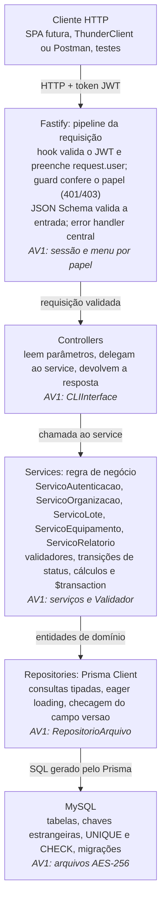

# AV2 – greencode: Entendendo a Atividade

As justificativas completas estão em `DECISOES.md`

## 1. Visão geral

A AV2 pede para transformar o greencode de uma CLI com arquivos criptografados (a AV1) em um **servidor monolítico HTTP com API REST**, persistindo em **banco relacional via Prisma ORM**. **IMPORTANTE:** o código importa, mas **a capacidade de justificar as decisões arquiteturais, trade-offs e alternativas rejeitadas é o que será mais valorizado**.

AV2: mesmo domínio (Organização, Contrato, Lote, Equipamento, Movimentação, usuários e papéis), mesmas regras de negócio, nova infraestrutura (Node + TypeScript + Fastify + Prisma + MySQL + JWT).

O que precisa existir ao final:

- Servidor HTTP em camadas Controller → Service → Repository (Prisma).
- `schema.prisma` com os modelos do domínio, migrações versionadas e script de seed.
- Autenticação stateless com JWT (acesso curto + refresh token) e autorização por papel.
- Transações (`$transaction`) e versionamento otimista nas operações críticas.
- API documentada, compatível com Windows 10+ e Ubuntu 24.04.03+ (e derivadas).
- Documento de decisões arquiteturais com justificativas e trade-offs (`DECISOES.md`).

## 2. O que muda da AV1 para a AV2

O domínio e as regras de negócio permanecem; mudam a interface, a persistência, a autenticação e o modelo de concorrência.

| Aspecto | AV1 (CLI) | AV2 (servidor) | O que fazer com o código |
| --- | --- | --- | --- |
| Interface | `CLIInterface` com readline, menu por papel | API REST HTTP (Fastify) | Substituir a CLI por controllers e rotas; a checagem `podeExecutar(modulo, acao)` vira guard de autorização por papel (hook do Fastify) |
| Persistência | Arquivos de texto com AES-256, escrita atômica via arquivo temporário | MySQL via Prisma ORM | `RepositorioArquivo` e `CriptografiaArquivo` são substituídos por repositórios Prisma |
| Auditoria | Journal em arquivo (rotação 10 MB, retenção 180 dias) | Tabela `JournalTransacao` no banco | Operações de domínio compartilham transação com o journal; eventos de autenticação são best-effort e independentes da transação de sessão |
| Autenticação | Sessões em memória, expiração em 30 min, SHA-256 | JWT de acesso curto + refresh token, senha com bcryptjs | `ServicoAutenticacao` + `Sessao` viram login, renovação, logout e hook de validação do token |
| Concorrência | Atomicidade por arquivo | `$transaction` + versionamento otimista | Identificar operações multi-passo e proteger com transação |
| Validações | Em código (CNPJ, datas, estados) | Em código e no banco (unique, constraints) | Manter os validadores e adicionar restrições no schema |
| Parâmetros globais | `ParametrosGlobais` (alíquota, depreciação, valor base) em arquivo | Tabela de configuração | Modelo `ConfiguracaoGlobal` com uma única linha |
| Dados de teste | Scripts de jornada de usuário | Script de seed no Prisma | Reproduzir os cenários de validação da AV1 |
| Provisionamento | Arquivo mestre com chave AES e 1º admin | Variáveis de ambiente + seed do 1º admin | Chave de criptografia deixa de existir; `JWT_SECRET` e `DATABASE_URL` entram |

O que **sai** do sistema: criptografia de arquivos, readline, histórico de comandos, rotação de arquivo de journal. O que **entra**: HTTP, banco relacional, migrações, JWT, validação de entrada por JSON Schema.

Reaproveitamento direto do código da AV1: `dominio`, `enums`, `validadores`, `fabricas` e a lógica dos `servicos`. Descartar: `persistencia`, `configuracao` e `cli`.

## 3. Arquitetura em camadas

O servidor é um monólito em camadas Controller → Service → Repository, e cada camada assume o papel de uma parte do sistema da AV1.



A regra de ouro: dependências só apontam para baixo. Services não importam nada do Fastify (`request`, `reply`) e controllers não importam o Prisma. Assim a mesma regra serve HTTP hoje e outra interface amanhã, como a atividade pede.

Possível estrutura de pastas:

```text
src/
  server.ts               # inicialização, porta por variável de ambiente, graceful shutdown
  app.ts                  # instância do Fastify, plugins e registro de rotas (/api/v1)
  plugins/                # jwt, swagger, guard por papel, tratador de erros
  dominio/                # entidades, enums, fábricas e validadores (vindos da AV1)
  modules/
    auth/  organizacoes/  lotes/  equipamentos/  relatorios/  configuracao/
      *.controller.ts  *.service.ts  *.repository.ts  *.schema.ts
prisma/
  schema.prisma  migrations/  seed.ts
docs/
  DECISOES.md  ...
```

Mapeamento das classes do UML: `CLIInterface` vira os controllers; `ServicoAutenticacao`, `ServicoOrganizacao`, `ServicoLote`, `ServicoEquipamento` e `ServicoRelatorio` viram os services; as entidades (`Organizacao`, `Contrato`, `Lote`, `Equipamento`, `Movimentacao`) viram models Prisma; `RepositorioArquivo` e `CriptografiaArquivo` saem de cena. A interface `Autenticavel` e as classes `Sessao` e `Credencial` se reduzem a login com JWT mais os modelos `Usuario` e `RefreshToken`.

## 4. Tecnologias

A pilha obrigatória é **Node.js + TypeScript + Prisma ORM**. A escolha pessoal de banco é **MySQL**; o framework é o **Fastify** recomendado pelo professor. Ambas estão justificadas em `DECISOES.md`. Itens marcados como sugestão vêm desta pesquisa, não do enunciado.

| Tecnologia | Papel no sistema | Origem | Por que usar / alternativa |
| --- | --- | --- | --- |
| Node.js | Runtime do servidor | Obrigatória | I/O não bloqueante; mesma linguagem do front-end SPA futuro |
| TypeScript | Tipagem dos contratos entre camadas | Obrigatória | Erros pegos em compilação; Prisma gera tipos |
| Prisma ORM | Camada de persistência, migrações, `$transaction` | Obrigatória | Schema declarativo e cliente tipado; alternativa seria TypeORM/Knex (fora da pilha) |
| Fastify | Servidor HTTP e rotas | Recomendada | Validação nativa por JSON Schema, tipos TypeScript embutidos, mais rápido que o Express; Express é a alternativa aceita |
| MySQL 8 | Banco relacional | Escolha pessoal (familiaridade) | ACID (InnoDB), JSON, `CHECK` desde 8.0.16; PostgreSQL é o recomendado no enunciado |
| `@fastify/jwt` | Assinar e verificar JWT | Recomendada | Integra com os hooks do Fastify |
| `bcryptjs` | Hash de senha | Escolha pessoal | JavaScript puro, instala sem compilar no Windows e no Ubuntu; substitui o SHA-256 da AV1 |
| dotenv / `process.env` | Porta, `DATABASE_URL`, `JWT_SECRET` | Exigida (porta por variável de ambiente) | Configuração fora do código |
| JSON Schema nativo (Ajv) + TypeBox | Validação de entrada e saída das rotas | Nativo; TypeBox é sugestão | O Fastify valida sem biblioteca extra; TypeBox gera schema e tipo TypeScript juntos (type provider) |
| `@fastify/swagger` + `@fastify/swagger-ui` | Documentação interativa (OpenAPI) | Sugestão | Gera a spec a partir dos schemas das rotas; cobre o requisito de "API documentada" |
| Vitest ou Jest + `tsx` | Testes e execução TS em dev | Sugestão | Prova que as regras da AV1 foram transportadas |
| Docker Compose (MySQL) | Banco local idêntico em Windows e Linux | Sugestão | Ajuda no requisito de multiplataforma |

## 5. Modelo de dados (schema.prisma)

O enunciado exige cinco modelos: `Organizacao`, `Contrato`, `Lote`, `Equipamento` e `Movimentacao`. Como o login agora consulta o hash no banco, é necessário um modelo `Usuario` (herdeiro de `Credencial` da AV1). Pelas decisões tomadas, entram ainda `RefreshToken`, `JournalTransacao` (auditoria) e `ConfiguracaoGlobal` (parâmetros globais).

| Relação | Cardinalidade | Observação |
| --- | --- | --- |
| Organizacao → Contrato | 1 para 0..1 | `Contrato.organizacaoId` com `@unique` |
| Organizacao → Lote | 1 para muitos | Lote sempre pertence a uma organização |
| Lote → Equipamento | 1 para 0..* | `loteId` obrigatório em Equipamento; lote pode existir vazio, mas não pode ser excluído se possuir equipamentos vinculados |
| Equipamento → Movimentacao | 1 para muitos | Histórico de rastreabilidade |
| Usuario → RefreshToken | 1 para muitos | Permite logout real por revogação |
| Usuario | independente | Guarda `hashSenha` e `papel` |
| JournalTransacao | independente | Guarda `usuarioResponsavel`, dados antes e depois |
| ConfiguracaoGlobal | linha única | Alíquota, coeficiente e valor base de depreciação |

Esboço dos modelos, a partir dos campos do UML (ajuste à versão do Prisma instalada; as linhas `generator` e `datasource` seguem a documentação da versão, com `provider = "mysql"`):

```prisma
enum PapelUsuario { ADMINISTRADOR OPERADOR_CADASTRO GESTOR_ALMOXARIFADO AUDITOR }
enum StatusLote { RECEBIDO EM_TRIAGEM TRIAGEM_CONCLUIDA ENCAMINHADO FINALIZADO }
enum EstadoFisico { NOVO BOM_ESTADO USADO_LEVE USADO_MODERADO DANIFICADO_LEVE DANIFICADO_GRAVE INSERVIVEL }
enum StatusRastreamento {
  AGUARDANDO_TRIAGEM EM_TRIAGEM AGUARDANDO_DESMONTE EM_DESMONTE
  PECAS_REAPROVEITADAS MATERIAL_RECICLAVEL DESCARTE_SEGURO BAIXA_DEFINITIVA
}
// TipoEquipamento: copiar os valores de src/enums/TipoEquipamento.ts

model Usuario {
  id            Int       @id @default(autoincrement())
  usuario       String    @unique
  hashSenha     String
  papel         PapelUsuario
  ultimoAcesso  DateTime?
  refreshTokens RefreshToken[]
}

model RefreshToken {
  id         Int      @id @default(autoincrement())
  usuarioId  Int
  usuario    Usuario  @relation(fields: [usuarioId], references: [id], onDelete: Cascade)
  tokenHash  String   @unique
  expiraEm   DateTime
  revogado   Boolean  @default(false)
  criadoEm   DateTime @default(now())
}

model Organizacao {
  id                Int       @id @default(autoincrement())
  razaoSocial       String
  cnpj              String    @unique
  inscricaoEstadual String?
  enderecoCompleto  String
  telefone          String?
  email             String?
  dataCadastro      DateTime  @default(now())
  ativo             Boolean   @default(true)
  versao            Int       @default(1)
  contrato          Contrato?
  lotes             Lote[]
}

model Contrato {
  id                  Int      @id @default(autoincrement())
  organizacaoId       Int      @unique
  organizacao         Organizacao @relation(fields: [organizacaoId], references: [id], onDelete: Restrict)
  dataAssinatura      DateTime
  dataVencimento      DateTime
  clausulas           Json
  valorMensal         Decimal  @db.Decimal(12, 2)
  renovacaoAutomatica Boolean  @default(false)
  versao              Int      @default(1)
}

model Lote {
  id                  Int      @id @default(autoincrement())
  organizacaoId       Int
  organizacao         Organizacao @relation(fields: [organizacaoId], references: [id], onDelete: Restrict)
  dataEntrada         DateTime
  notaFiscal          String
  transportadora      String
  statusProcessamento StatusLote @default(RECEBIDO)
  observacoes         String?
  versao              Int      @default(1)
  equipamentos        Equipamento[]
}

model Equipamento {
  id                  Int     @id @default(autoincrement())
  codigoBarrasInterno String  @unique
  loteId              Int
  lote                Lote    @relation(fields: [loteId], references: [id], onDelete: Restrict)
  posicaoNoLote       Int
  estadoFisico        EstadoFisico
  statusRastreamento  StatusRastreamento @default(AGUARDANDO_TRIAGEM)
  pesoQuilogramas     Decimal @db.Decimal(8, 3)
  versao              Int     @default(1)
  movimentacoes       Movimentacao[]
  // tipo, marca, modelo, anoFabricacao

  @@unique([loteId, posicaoNoLote])
}

model Movimentacao {
  id            Int      @id @default(autoincrement())
  equipamentoId Int
  equipamento   Equipamento @relation(fields: [equipamentoId], references: [id], onDelete: Restrict)
  dataHora      DateTime @default(now())
  origem        String
  destino       String
  responsavel   String
  observacao    String?
}

model JournalTransacao {
  id                 Int      @id @default(autoincrement())
  timestamp          DateTime @default(now())
  operacao           String
  entidade           String
  dadosAntes         Json?
  dadosDepois        Json?
  usuarioResponsavel String

  @@index([timestamp])
  @@index([entidade])
}

model ConfiguracaoGlobal {
  id                     Int     @id @default(1)
  aliquotaImpostos       Decimal @db.Decimal(5, 4) @default(0.18)
  coeficienteDepreciacao Decimal @db.Decimal(5, 4) @default(0.2)
  valorBaseDepreciacao   Decimal @db.Decimal(12, 2) @default(1000)
}
```

Decisões tomadas (detalhadas em `DECISOES.md`): chave inteira autoincremental (e não UUID), `Decimal` (e não `Float`) para dinheiro e peso, `Json` (e não tabela própria) para as cláusulas do contrato. Atributos calculados do UML (`calcularPesoTotal`, `calcularDepreciacao`, `estaVigente`) ficam em serviços, não no banco.

## 6. Autenticação JWT e autorização por papel

O login troca credenciais por um **access token** JWT de vida curta (com id do usuário e papel) e um **refresh token** guardado no banco. Cada requisição envia o access token em `Authorization: Bearer <token>` e um hook do Fastify o valida antes de chegar ao controller.

1. `POST /api/v1/auth/login` recebe usuário e senha.
2. O serviço busca o usuário no banco e compara a senha com o hash (bcryptjs).
3. Em caso de sucesso, assina um JWT com `sub` (id) e `papel` (sugestão: 15 min) e cria um refresh token aleatório, guardando apenas o hash dele na tabela `RefreshToken` (sugestão: 30 min, renovado a cada uso).
4. Um hook `onRequest` verifica o access token nas rotas protegidas e preenche `request.user`.
5. Um segundo passo (guard por rota, em `preHandler`) confere se o `papel` pode executar aquela ação; senão, responde 403.
6. `POST /api/v1/auth/refresh` troca um refresh token válido por um novo par de tokens (o antigo é revogado); `POST /api/v1/auth/logout` revoga o refresh token.

Matriz de permissões confirmada no código da AV1 (`CLIInterface.podeExecutar`):

| Capacidade | Administrador | Operador de cadastro | Gestor de almoxarifado | Auditor |
| --- | --- | --- | --- | --- |
| Gerir contas de acesso | Sim | Não | Não | Não |
| Parâmetros globais (alíquota, depreciação) | Sim | Não | Não | Não |
| Cadastrar, consultar e renovar organizações e contratos | Sim | Sim | Não | Não |
| Registrar lotes e triagem | Sim | Não | Sim | Não |
| Alterar estado, movimentar e calcular depreciação de equipamentos | Sim | Não | Sim | Não |
| Rastrear equipamento (histórico) | Sim | Não | Sim | Sim |
| Gerar relatórios | Sim | Não | Não | Sim |

Decisões que o relatório justifica:

- **Expiração.** Access token curto + refresh token aproxima a "expiração por inatividade de 30 min" da AV1, mas não a reproduz de forma exata.
- **Revogação.** O access token não é revogável antes de expirar (por isso é curto); o refresh token é revogável via banco, o que dá um `logout` real.
- **Segredo.** `JWT_SECRET` vem de variável de ambiente, nunca do repositório.
- **Senha.** Hash com bcryptjs e custo configurável; nunca devolver `hashSenha` em respostas da API.
- **IDs previsíveis.** Com chave inteira, `/lotes/1` é adivinhável; por isso toda rota passa pelo hook de autenticação e pelo guard de papel.

## 7. Regras de negócio

A AV2 não lista regras novas de domínio: ela pede que as regras da AV1 sejam "corretamente transportadas" e reforçadas no banco. Esta tabela reúne todas, já conferidas com o código da AV1.

| Regra | Origem | Onde implementar | Erro HTTP sugerido |
| --- | --- | --- | --- |
| CNPJ válido (dígitos verificadores) e único | AV1 + AV2 | `ValidadorCNPJ` no service **e** `UNIQUE` no banco | 400 (inválido), 409 (duplicado) |
| Lote: data de entrada não pode ser futura nem anterior a 90 dias | AV1 | `ValidadorDataEntrada` no `ServicoLote` | 422 |
| Equipamento só entra em `EM_DESMONTE` se estiver em `AGUARDANDO_DESMONTE` (triagem completa) | AV1 (`Equipamento.atualizarStatus`) | Regra de transição em `ServicoEquipamento`, dentro de transação | 409 ou 422 |
| Toda mudança de status exige justificativa não vazia | AV1 (`Equipamento.atualizarStatus`) | `ServicoEquipamento` | 422 |
| Piora de estado físico em 2 ou mais categorias exige justificativa textual | AV1 (`Equipamento.atualizarEstadoFisico`) | Compara a posição no enum `EstadoFisico` | 422 |
| `codigoBarrasInterno` único; sequência inteira positiva, formato `TIPO-000001` | AV1 + AV2 | `gerarCodigoBarras(tipo, sequencia)` + `UNIQUE` | 400 ou 409 |
| Alíquota e coeficiente de depreciação entre 0 e 1 | AV1 (`ParametrosGlobais`) | Validação no service de configuração + `CHECK` | 422 |
| Lote contém 1 ou mais equipamentos | UML | Criação de lote e equipamentos na mesma transação | 422 |
| Organização tem 0 ou 1 contrato; `estaVigente()` consulta vencimento | UML | `UNIQUE` em `Contrato.organizacaoId`; método no service | 409 |
| Papéis restringem ações; auditor só consulta | AV1 | Guard por rota (seção 6) | 403 |
| Toda movimentação registra destino, responsável e data | UML | `Movimentacao` criada junto com a mudança de status | 422 |
| Auditoria de operações de domínio | AV1 | Tabela `JournalTransacao`, gravada na mesma transação das operações que compartilham a transação | n/a |

Pontos resolvidos pelo código da AV1:

- **"Duas categorias abaixo"**: `EstadoFisico` é uma escala ordenada (`NOVO` = 0 até `INSERVIVEL` = 6); exige justificativa quando `novo - anterior >= 2`.
- **"Triagem completa"**: vale pelo status do **equipamento** (`AGUARDANDO_DESMONTE`), não pelo status do lote.
- **Regras da AV1 que saem**: criptografia AES, rotação de arquivo de 10 MB e provisionamento por arquivo mestre deixam de fazer sentido. Registrado como decisão.
- **Retenção do journal**: não há política de limpeza automática implementada; a decisão de retenção permanece pendente e está registrada em `DECISOES.md`.

Dica de design da atividade: colocar as regras em funções puras dentro dos services e testá-las isoladamente. É isso que garante que a lógica de negócio "permaneça imune a mudanças na interface".

## 8. Transações e concorrência

Como várias requisições podem tocar o mesmo registro ao mesmo tempo, toda operação que altera mais de uma linha deve usar `prisma.$transaction`, e toda atualização deve checar o campo `versao`.

Operações que precisam de transação:

| Operação | Passos que devem ser atômicos |
| --- | --- |
| Criar lote com equipamentos | Inserir `Lote`, inserir N `Equipamento`, gerar códigos de barras únicos, registrar journal |
| Atualizar status ou estado de equipamento | Validar regra, atualizar `Equipamento`, inserir `Movimentacao`, registrar journal |
| Concluir triagem do lote | Atualizar status do lote e dos equipamentos relacionados, registrar journal |
| Renovar contrato | Atualizar vencimento e registrar journal |
| Renovar refresh token | Revogar o token antigo e criar o novo |

Versionamento otimista, em três passos:

1. O cliente lê o registro e recebe `versao` (ex.: 3).
2. Ao atualizar, envia `versao: 3`. O service executa `updateMany({ where: { id, versao: 3 }, data: { ..., versao: { increment: 1 } } })`.
3. Se `count === 0`, outra requisição alterou antes: responder **409 Conflict** e pedir que o cliente releia.

Cuidado com a geração de `codigoBarrasInterno`: calcular a próxima sequência fora da transação causa colisão sob concorrência. Gerar dentro da transação, usar uma sequência do banco ou confiar no `UNIQUE` e tentar de novo em caso de violação (erro `P2002` do Prisma).

## 9. Seed, migrações e integridade no banco

O banco passa a ser a última linha de defesa: a validação no service dá mensagens boas, mas só uma constraint impede dado inconsistente quando duas requisições disputam o mesmo registro.

Seed (`prisma/seed.ts`, executado por `prisma db seed`) deve criar, no mínimo:

- Um usuário para cada um dos quatro papéis, com senha em hash.
- A linha única de `ConfiguracaoGlobal` com os valores padrão da AV1 (alíquota 0,18; coeficiente 0,2; valor base 1000).
- Organizações com CNPJ válido, algumas com contrato vigente, outras com contrato vencido e outras sem contrato.
- Lotes em cada `StatusLote`.
- Equipamentos em estados físicos e status de rastreamento variados, com movimentações em histórico.
- Casos que reproduzam as validações da AV1 (ex.: lote antigo demais, piora de dois níveis de estado), para testar a rejeição.

Migrações: usar `prisma migrate dev` e versionar a pasta `prisma/migrations` no Git. Cada mudança de schema gera um arquivo SQL revisável.

Restrições a colocar no banco:

| Restrição | Como |
| --- | --- |
| CNPJ único | `@unique` em `Organizacao.cnpj` |
| Código de barras único | `@unique` em `Equipamento.codigoBarrasInterno` |
| Um contrato por organização | `@unique` em `Contrato.organizacaoId` |
| Posição única dentro do lote | `@@unique([loteId, posicaoNoLote])` |
| Valores válidos (peso > 0, vencimento > assinatura, alíquota e coeficiente entre 0 e 1) | `CHECK` em SQL dentro do arquivo de migração (o Prisma não declara `CHECK` no schema; no MySQL só são aplicadas a partir da versão 8.0.16) |
| Integridade referencial | Relações com `onDelete: Restrict` para não perder histórico |

O enunciado cita triggers ou constraints; constraints `CHECK` costumam bastar e são mais simples de manter.

## 10. Servidor HTTP e API REST

Dois requisitos explícitos: a **porta vem de variável de ambiente** e o servidor faz **graceful shutdown**. O resto da API é desenho próprio; a tabela abaixo é um rascunho que cobre os comandos da CLI da AV1. Todas as rotas ficam sob o prefixo `/api/v1`, pensando na atividade seguinte.

| Recurso | Rotas sugeridas | Quem escreve |
| --- | --- | --- |
| Autenticação | `POST /auth/login`, `POST /auth/refresh`, `POST /auth/logout`, `POST /auth/alterar-senha` | Qualquer usuário |
| Usuários | `POST/GET /usuarios` | Administrador |
| Configuração | `GET/PATCH /api/v1/configuracao` | Administrador |
| Organizações | `POST /organizacoes`, `GET /organizacoes`, `GET /organizacoes/:id`, `PATCH /organizacoes/:id` | Operador de cadastro |
| Contratos | `PUT /organizacoes/:id/contrato`, `POST /organizacoes/:id/contrato/renovar` | Operador de cadastro |
| Lotes | `POST /lotes`, `GET /lotes?inicio=&fim=`, `POST /lotes/:id/equipamentos`, `POST /lotes/:id/triagem` | Gestor de almoxarifado |
| Equipamentos | `GET /equipamentos/:id/historico`, `PATCH /equipamentos/:id/estado-fisico`, `PATCH /equipamentos/:id/status`, `POST /equipamentos/:id/movimentacoes` | Gestor de almoxarifado |
| Relatórios | `GET /relatorios/organizacao/:id`, `/relatorios/status`, `/relatorios/financeiro` | Auditor e administrador (leitura) |

Os três relatórios correspondem aos métodos de `ServicoRelatorio` no UML. Usar o verbo HTTP e o código de status corretos: 201 na criação, 400/422 em validação, 401 sem token, 403 sem permissão, 404 inexistente, 409 em conflito.

O que o servidor precisa fazer na inicialização e no encerramento:

- Ler `PORT`, `DATABASE_URL` e `JWT_SECRET` do ambiente, falhando com mensagem clara se faltar algo. Ouvir em `0.0.0.0` ao rodar em Docker ou na AWS (por padrão o Fastify escuta só em `localhost`).
- Registrar plugins (JWT, swagger) e rotas por módulo (`auth`, `organizacoes`, `lotes`, `equipamentos`, `relatorios`, `configuracao`), cada módulo como plugin.
- Validar entrada e saída com JSON Schema do Fastify, declarado em cada rota.
- Um `setErrorHandler` central, que converte exceções de domínio e erros do Prisma em status HTTP.
- Ao receber `SIGINT` ou `SIGTERM`: `await app.close()` (para de aceitar conexões e finaliza as ativas) e `await prisma.$disconnect()`.

No Windows, `SIGTERM` não é entregue como no Linux; `SIGINT` (Ctrl+C) funciona nos dois. Testar o encerramento nas duas plataformas.

## 11. Compatibilidade de plataformas

O sistema deve rodar em **Windows 10 ou superior**, **Ubuntu 24.04.03 ou superior** e distribuições derivadas do Ubuntu. Isso é requisito de comercialização, então testar nas duas famílias e documentar o passo a passo.

| Ponto de atenção | Risco | Mitigação |
| --- | --- | --- |
| Dependências nativas (binários do Prisma) | Falha de instalação | Prisma distribui binários para ambos; `bcryptjs` (JavaScript puro) evita compilação |
| Caminhos de arquivo | Barras `/` e `\` | Usar `path.join` e nunca concatenar strings de caminho |
| Scripts do `package.json` | Sintaxe de variável de ambiente difere (`VAR=x cmd` não funciona no Windows) | Usar `cross-env` ou ler o `.env` com dotenv |
| Final de linha | CRLF versus LF quebra scripts shell | `.gitattributes` com `* text=auto eol=lf` |
| Banco de dados | Instalar MySQL manualmente é trabalhoso | Fornecer `docker-compose.yml` e documentar instalação nativa como alternativa |
| Versão do MySQL | `CHECK` só é aplicada a partir da 8.0.16 | Fixar MySQL 8 no Docker e no README |
| Sinais de encerramento | `SIGTERM` no Windows | Tratar `SIGINT` e `SIGTERM` (seção 10) |
| Versão do Node | Diferenças entre versões | Fixar com campo `engines` e `.nvmrc` (Node LTS) |

Entregar um `README` com os comandos de instalação, migração, seed e execução para Windows (PowerShell) e Ubuntu (bash). A evidência em Linux será obtida em uma instância na AWS, com capturas de tela; o Windows é testado na máquina local.

## 12. Entregáveis e justificativa das decisões

O enunciado não lista entregáveis formais, mas descreve o resultado esperado: servidor funcional, **API documentada**, **banco normalizado**, código em camadas e, acima de tudo, **justificativa das decisões, trade-offs e alternativas rejeitadas**. Na AV1 foi entregue código, testes e documentação de segurança; tratar a AV2 do mesmo modo.

Entregáveis prováveis:

- [ ] Repositório Git com código TypeScript organizado em camadas.
- [ ] `schema.prisma`, pasta de migrações e `seed.ts`.
- [ ] API documentada (OpenAPI/Swagger ou documento equivalente).
- [ ] Testes das regras de negócio e de um fluxo completo (login → cadastro → lote → triagem → movimentação → rastreabilidade).
- [ ] `README` de instalação para Windows e Ubuntu.
- [ ] `docs/DECISOES.md` com as decisões arquiteturais.

Decisões tomadas, com a alternativa descartada e o trade-off (versão completa em `DECISOES.md`):

| Decisão | Alternativa rejeitada | Trade-off a discutir |
| --- | --- | --- |
| Monólito em camadas | Microsserviços | Simplicidade de implantação e depuração versus escala independente por módulo |
| Fastify | Express | Validação e tipagem nativas, desempenho e recomendação do professor versus familiaridade e ecossistema maior do Express |
| MySQL | PostgreSQL | Familiaridade versus recursos avançados e recomendação do enunciado |
| Prisma ORM | SQL manual, outro ORM | Produtividade e tipos versus controle fino do SQL |
| JWT curto + refresh token | Token único; sessões no servidor | Inatividade e logout real versus mais código e estado no banco |
| bcryptjs | SHA-256 da AV1; bcrypt nativo | Instalação portátil versus desempenho um pouco menor |
| IDs inteiros autoincrementais | UUID | Índices menores versus IDs previsíveis |
| `Decimal` | `Float` | Precisão exata versus conversão na serialização |
| Cláusulas em `Json` | Tabela própria | Flexibilidade e fidelidade à AV1 versus menor normalização |
| Versionamento otimista | Lock pessimista | Menos bloqueio versus tratamento de conflito pelo cliente |
| Auditoria em tabela | Arquivo de journal da AV1 | Consulta e atomicidade versus perda da rotação por arquivo |
| Constraints no banco | Só validação no service | Defesa em profundidade versus duplicação de regra |

Também explicar os limites do monólito (a atividade pede essa reflexão): o que levaria a separar módulos no futuro, como relatórios ou autenticação.

## 13. Plano de execução

A ordem abaixo reduz retrabalho: primeiro o que tudo depende (banco e esqueleto), depois autenticação, depois o domínio, e por fim o que dá acabamento.

1. **Preparar o ambiente.** Repositório novo, `npm init`, TypeScript, Fastify, Prisma, MySQL 8 via Docker. Copiar da AV1 `dominio`, `enums`, `validadores` e `fabricas`. Verificar que sobe em Windows e Ubuntu.
2. **Modelar o banco.** Escrever `schema.prisma`, rodar a primeira migração, adicionar `CHECK` em SQL e o campo `versao`.
3. **Esqueleto do servidor.** Porta por variável de ambiente, estrutura de pastas, error handler e graceful shutdown.
4. **Autenticação.** Modelos `Usuario` e `RefreshToken`, login com bcryptjs, JWT, refresh, logout, hook de validação e guard por papel.
5. **Portar os validadores da AV1.** `ValidadorCNPJ`, `ValidadorDataEntrada` e demais regras como funções reutilizáveis, com testes.
6. **Organização, contrato e configuração.** Repositório, serviço, controller, rotas.
7. **Lote e equipamento.** Criação de lote com equipamentos em transação, geração de código de barras, triagem, transições de status, movimentações.
8. **Concorrência.** Aplicar `versao` e tratar 409 em todas as atualizações.
9. **Relatórios e auditoria.** `ServicoRelatorio` e `JournalTransacao` gravado nas transações.
10. **Seed e testes de jornada completa.**
11. **Documentação.** Swagger, `README`, `DECISOES.md` revisado.
12. **Validação final** nas duas plataformas (AWS para Ubuntu) e checklist da seção 12.

Um bom marco intermediário: ter o passo 4 funcionando de ponta a ponta (login com token, refresh e rota protegida por papel) antes de escrever os módulos de domínio.

## 14. Pontos de atenção e ambiguidades

O enunciado está deliberadamente aberto. Há pontos de decisão que devem ser registrados no relatório e, se possível, confirmados com o professor.

- **Interface.** O texto fala em consumo por um front-end SPA, mas não pede o front-end nesta atividade. Entregar somente a API, testada pelo ThunderClient e/ou outras ferramentas.
- **Escopo dos modelos.** Só cinco modelos são citados; usuário, refresh token, auditoria e configuração são necessários na prática. Confirmar com o professor se isso é aceitável.
- **Parâmetros globais.** Resolvido: viram o modelo `ConfiguracaoGlobal`, editável só pelo administrador.
- **Migração dos dados da AV1.** O enunciado aceita reinserir dados de teste, mas recomenda seed. Importar arquivos criptografados antigos não é exigido.
- **Banco alvo.** Decidido: MySQL, por familiaridade (o enunciado recomenda PostgreSQL e cita MySQL como possibilidade).
- **Framework.** Decidido: Fastify, recomendado pelo professor, com validação nativa por JSON Schema e suporte embutido a TypeScript (Express seria a alternativa aceita).
- **"Compatível com Windows e Ubuntu"** não diz como será verificado; preparar evidência. Usar a AWS para o Ubuntu, com capturas de tela, e testar o Windows localmente.
- **Retenção do journal.** Definir se os 180 dias da AV1 continuam (limpeza agendada) ou se nada é apagado.
- **Atividade seguinte.** O material do `greencode.txt` indica que a próxima etapa adiciona camada analítica e API pública com chaves de API e `rate-limit`. Manter os services desacoplados do Fastify e usar o prefixo `/api/v1` desde já.

## 15. Estado implementado e limitações atuais

Esta seção descreve o código presente, distinguindo-o das propostas históricas das seções anteriores.

- **Camadas:** os módulos seguem a divisão em routes, controllers, services e repositories; as regras de domínio e validação compartilhada estão em `src/dominio/`.
- **Tecnologias:** o projeto usa Node.js 22.12+, TypeScript, Fastify, Prisma 7.10.1, `@prisma/adapter-mariadb` e MySQL 8.0.16+.
- **Autenticação:** access token JWT, refresh token persistido por hash, rotação e revogação. Eventos de login, falhas de login, logout válido, rotação e reutilização de refresh token conhecido são registrados por uma escrita best-effort no journal, separada da transação da sessão. Tokens opacos desconhecidos não são persistidos para evitar inundação. Não se afirma atomicidade entre esses eventos e a operação de sessão.
- **Auditoria:** operações de domínio que passam `tx` a `registrarJournal` gravam o journal dentro da transação. `GET /api/v1/auditoria/journal` é somente leitura, paginado e restrito a `ADMINISTRADOR` e `AUDITOR`; snapshots são filtrados para remover chaves de campos sensíveis.
- **Triagem:** `resultadoTriagem` representa a decisão de destino; `statusRastreamento` representa o estado operacional. Dados históricos não recebem automaticamente uma decisão inferida.
- **Baixa definitiva:** operação separada, com autorização, justificativa, versão e campos de auditoria.
- **Relatórios:** o financeiro considera contratos que estiveram vigentes em algum momento do período, incluindo encerramento antecipado. Os valores são mensais contratuais, não receita recebida/reconhecida. O relatório por organização agrupa pelo status atual dos equipamentos, não por estado histórico no fim do período.
- **Configuração:** a linha global é inicializada pelo seed e o endpoint GET é somente leitura. A constraint SQL para `valorBaseDepreciacao` ainda depende da verificação de dados existentes antes de uma migração corretiva.
- **Ambientes:** `logistica_db` é o banco de desenvolvimento; `logistica_db_test` é exclusivo da suíte de integração. A configuração de teste recusa nomes que não terminem em `_test`.
- **Cancelamento de lotes:** não implementado; aguarda definição e aprovação das regras de negócio.
- **Execução e testes:** os comandos atuais e os passos para PowerShell/Ubuntu estão no README. O ZIP por si só não comprova que os comandos foram executados no ambiente de destino.
